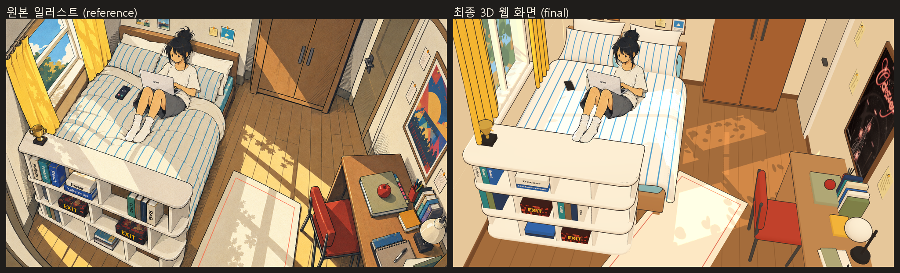
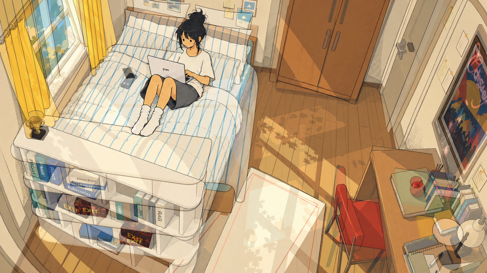

# 레퍼런스 재현 보고서

작업 기간: 2026-10-14 02:05 ~ 03:45 (자율 진행)
기준 원본: `ref_pics/방구조 및 물건 배치.png` → [reference-original.png](reference-match/reference-original.png)
작업 전 체크포인트: git 태그 `checkpoint/before-reference-match` (로컬)

## 한눈에 보기

| 원본 vs 최종 | 50% 오버레이 |
|---|---|
|  |  |

- 작업 전후: [before-after.png](reference-match/before-after.png)
- 캐릭터 비교: [character-closeup.png](reference-match/character-closeup.png)
- 커튼 비교: [curtain-closeup.png](reference-match/curtain-closeup.png)
- 최종 화면 단독: [final-room.png](reference-match/final-room.png)

**요약**: 기본 카메라에서 원본과 같은 구도로 같은 방이 보이도록 했어요. 비교한 주요 기준점 18개의 평균 오차는 **29px(이미지 대각선의 1.5%)**예요. 다만 원본은 어안렌즈처럼 휘어 있고 기하학적으로 일관되지 않은 그림이라, 실제 3D 공간으로는 완전히 같게 만들 수 없어요. 남은 차이는 아래 4절에 정리했어요.

---

## 1. 수정한 파일과 모델

**설정**
- `src/config/room.ts`: 카메라, 방 크기, 가구 배치를 원본에 맞춘 값으로 바꿨어요(2절 참고). 커튼 길이, 러그 회전, 캐릭터 설정을 추가했어요.
- `src/config/palette.ts`: 원본에서 추출한 색으로 바꾸고 역할을 추가했어요(옷장, 시트, 의자, 사과 등). 줄무늬·테두리 색과 책 표지 색도 추가했어요.

**렌더링**
- `src/components/scene/Block.tsx`: 툰 셰이딩(3단계 명암)과 물체 좌표 기준 패턴(줄무늬·테두리)을 넣었어요. 윤곽선은 픽셀 단위로 일정하고, 화면 높이에 비례해 굵기가 바뀌어요.
- `src/components/scene/Lights.tsx`: 따뜻한 주변광, 창으로 들어오는 햇빛, 바닥 빛줄기용 스포트라이트(쿠키 투사)를 설정했어요.
- `src/components/scene/textures.ts` (새 파일): 코드로 그린 텍스처예요. 창밖 하늘과 나무, 나뭇잎 그림자판, 빛줄기 쿠키, 책 제목 라벨, 벽 사진과 메모가 있어요.
- `src/components/scene/RoundedSlab.tsx` (새 파일): 평면 모서리가 둥근 판이에요. 책장의 둥근 실루엣에 써요.
- `src/components/scene/RoomShell.tsx`: 바닥 마루 이음선, 걸레받이를 추가했어요. 벽 이음매에는 윤곽선이 생기지 않게 했어요.
- `src/App.tsx`: 톤 매핑을 껐어요(`flat`, 팔레트 색이 그대로 나오게). 자유 시점 상태를 컨텍스트로 전달해요.

**가구와 소품**
- `Bookshelf.tsx`: 둥근 선반 구조로 바꿨어요. 원본의 책 배치와 제목(Python, React, Docker, Kubernetes, CURD, RAG)을 넣고 EXIT 상자 2개를 추가했어요.
- `BedModel.tsx`: 이불과 베개에 파란 줄무늬, 하늘색 시트를 적용했어요. 베개는 4개예요.
- `Window.tsx`: 창턱을 얕게 하고(돌출 4.5cm), 창밖 하늘·나무와 나뭇잎 그림자판, 커튼봉 끝 장식을 추가했어요.
- `Desk.tsx`: 옆판 1개와 다리 2개 구조로 바꿨어요.
- `Chair.tsx`: 붉은 쿠션 좌판·등받이와 검은 파이프 프레임으로 바꿨어요.
- `Props.tsx`: 트로피(손잡이), 돔 스탠드, 세워 둔 책, 사과 올린 큰 책, 노란 메모장, 스프링 노트와 펜, 펜꽂이예요.
- `WallDecor.tsx`: 정리한 포스터, 사진 액자, 메모예요.
- `Rug.tsx`: 회전 배치와 얇은 붉은 테두리를 적용했어요.
- `Wardrobe.tsx`, `Door.tsx`: 색 역할만 바꿨어요.
- `CharacterPlaceholder.tsx`: 2D 캐릭터 레이어(`Character`)를 추가하고, 기존 플레이스홀더는 유지했어요.

**모델과 텍스처**
- `tools/blender/build_bed.py`: 새 치수(1.47×2.37m, 헤드보드 0.64m)로 바꾸고, 베개 4개, 두꺼운 이불을 만들어요 → `public/models/bed.glb`
- `tools/blender/build_curtain.py`: S자 휨을 없앴어요. 넓고 얕은 주름 4개, 패널별 길이 → `public/models/curtain.glb`
- `tools/clean_poster.py` (새 파일): 포스터의 인스타그램 격자선과 아이콘을 지워요 → `public/textures/festival-poster-clean.jpg`. 원본 파일은 그대로예요.
- `tools/extract_character.py` (새 파일): 원본에서 캐릭터를 분리해요(로컬 rembg `isnet-anime` 모델) → `public/textures/character.png`

**검증 도구**
- `tools/measure_landmarks.mjs` (새 파일): 기준점 오차를 측정해요 → [landmarks.json](reference-match/landmarks.json)
- `tools/make_comparisons.py` (새 파일): 비교 이미지를 만들어요.

**그대로 둔 것**
- 블록아웃 모델은 그대로 있어요. `?bed=blockout`, `?curtain=blockout`, `?character=placeholder`로 전환할 수 있어요.
- 배포 설정(`.github/workflows/deploy.yml`)은 바꾸지 않았어요.

## 2. 구현 완료 항목

1. **카메라와 배치 동시 맞춤.** 원본에서 기준점 21개를 읽었어요. 카메라 8개 변수와 방·가구 배치 변수를 함께 최적화했어요. 가구 크기와 위치에는 현실적인 범위를, 벽 안쪽·침대 발치의 책장 같은 조건에는 물리 제약을 걸었어요.
   - 카메라만 맞췄을 때는 오차가 91px였는데, 함께 맞추니 22px까지 줄었어요.
   - 배럴 왜곡 항도 시험했지만 이득이 없어서(21.9px → 22.3px) 넣지 않았어요.
   - Perspective와 Orthographic 중에는 Perspective를 택했어요. 원본에서 양쪽 벽이 동시에 보이는데, Orthographic으로는 그렇게 보이지 않아요.
2. **S자 커튼 수정.**
   - 원인: 창턱이 12cm 튀어나와 있었는데 커튼은 벽에서 8cm에 걸려 있었어요. 창턱이 커튼을 뚫어서, 그걸 피하려고 커튼 몸통을 휘게 만들었어요.
   - 해결: 창턱 돌출을 4.5cm로 줄이고, 커튼을 벽에서 9cm에 걸었어요. 주름 깊이는 최대 3cm로 해서, 가장 깊은 주름 골도 벽에서 5.7cm에 있어 창턱보다 앞이에요.
   - 결과: 몸통이 수직으로 떨어지고, 패널마다 넓고 얕은 주름 4개가 있어요.
   - 길이: 앞쪽 패널은 원본처럼 책장 윗면(트로피 옆)에서 끝나요(1.24m). 뒤쪽 패널은 침대 바로 위에서 끝나요(1.66m).
   - 확인: Blender MCP로 정면·측면·평면을 보고, 웹 카메라에서 원본과 비교했어요.
3. **침구.** 이불은 포근한 두께로 옆으로 흘러내리고, 파란 줄무늬가 길이 방향으로 나 있어요. 시트는 하늘색이에요. 베개는 원본처럼 흰 베개 2개(뒤)와 줄무늬 베개 2개(앞)예요.
4. **책장.** 둥근 앞 모서리의 긴 선반으로, 원본 실루엣과 같아요. 책 제목과 EXIT 상자를 원본 배치에 맞췄고, 트로피도 원본 위치에 있어요.
5. **책상과 의자.** 원본의 크기와 비율을 따랐고, 소품을 원본 순서대로 놓았어요. 붉은 의자 위치는 기준점 오차가 1px예요.
6. **옷장, 문, 포스터, 러그, 벽 메모, 휴대폰.** 원본 위치에 있어요. 러그 모서리 오차는 1~2px예요.
7. **캐릭터.** 원본 캐릭터를 분리해서 2D 레이어로 배치했어요(5절 참고).
8. **그림체.**
   - 원본에서 추출한 색, 툰 명암 3단계, 일정한 연필 굵기 윤곽선을 적용했어요.
   - 반사광, AO, 노이즈, 해칭은 넣지 않았어요.
   - 지시대로 질감 없이 깨끗한 색면 상태에서 먼저 원본과 비교했어요.
9. **조명.** 창으로 들어오는 햇빛과 나뭇잎 그림자가 침대에 떨어져요. 침대와 책상 사이 바닥, 러그 위에는 나뭇잎 그림자가 섞인 빛줄기가 있어요.
10. **포스터.** 인스타그램 격자선 4줄과 아이콘만 지운 별도 텍스처예요. 포스터 내용은 그대로예요.

## 3. 원본과 일치하는 부분

기준점 측정 결과예요(1672×941 기준, [landmarks.json](reference-match/landmarks.json)).

| 기준점 | 오차 | 기준점 | 오차 |
|---|---|---|---|
| 의자 좌판 중심 | 1px | 러그 모서리 2곳 | 1~2px |
| 옷장 아래 오른쪽 | 5px | 헤드보드 왼쪽 위 | 11px |
| 트로피 | 11px | 문틀 아래 | 11px |
| 책상 모서리 2곳 | 18~24px | 문 아래 앞쪽 | 28px |
| 책장 아래 오른쪽 | 32px | 헤드보드 오른쪽 위 | 37px |
| 옷장 아래 왼쪽 | 41px | 책장 위 양 끝 | 41~42px |
| 포스터 모서리 | 33~50px | **평균(RMS)** | **29px (1.5%)** |

눈으로 비교해도 일치하는 부분이에요.
- **구도**: 왼쪽 위 창문·커튼, 왼쪽 침대, 침대 발치 책장, 오른쪽 위 옷장·문, 오른쪽 벽 포스터, 오른쪽 아래 책상·의자, 가운데 비스듬한 러그.
- **캐릭터**: 얼굴, 머리, 시선(노트북), 옷차림, 자세가 원본과 같아요. 원본 픽셀을 그대로 쓰기 때문이에요.
- **색 관계**: 크림색 벽과 침구, 파란 줄무늬, 노란 커튼, 붉은 의자, 나무색 가구, 검은 바탕에 분홍 포인트인 포스터.

## 4. 아직 차이가 남아 있는 부분 (솔직한 평가)

1. **어안 원근은 재현할 수 없어요.**
   - 원본은 가장자리가 휘고, 가까운 물체(책장)가 과장되게 크고 낮게 그려진 그림이에요. 한 대의 카메라로는 모든 지점을 동시에 맞출 수 없어요.
   - 그래서 책장 윗면 앞 모서리의 기울기와 포스터 모서리가 40~50px 어긋나요.
   - 원본은 양쪽 벽이 둥글게 휘어 더 많이 보이는데, 최종 화면은 직선 원근이에요.
2. **캐릭터는 3D 모델이 아니라 2D 레이어예요.**
   - 기본 카메라에서는 원본과 똑같이 보여요.
   - 자유 시점에서는 얇은 카드로 보여요. 기본 시점이 아니면 어색해요.
   - 원본의 연필 질감 그대로라서, 깨끗한 색면인 방과 질감이 살짝 달라요.
   - 이불 주름 일부가 캐릭터 가장자리에 아주 작게 남아 있어요.
3. **침구 디테일.**
   - 원본 이불의 가로 누빔(퀼팅)과 볼록볼록한 덩어리감은 없어요. 줄무늬만 있고 표면은 매끈해요.
   - 원본 침대는 실제 사진보다 짧고 통통하게 그려져 있어요. 3D에서는 침대 길이 2.37m로 타협했어요.
4. **햇빛.**
   - 바닥 빛줄기는 물리적인 햇빛이 아니라 연출용 스포트라이트예요. 원본의 빛 방향은 이 방의 창 위치와 맞지 않아요.
   - 원본에 있는 책장 윗면과 왼쪽 아래 바닥의 빛 조각은 재현하지 않았어요.
   - 빛줄기 모양도 원본보다 덜 길쭉해요.
5. **창밖 풍경**: 코드로 그린 단순한 하늘과 나무예요. 원본의 구름과 나무 묘사보다 단순해요.
6. **벽 장식**: 원본에서는 헤드보드 위에 사진 2장과 메모·카드가 잘 보이는데, 최종 화면에서는 화면 위쪽 가장자리에 일부만 보여요.
7. **색감**: 바닥과 옷장이 원본보다 조금 밝고 주황빛이에요. 원본의 진한 그늘(바닥 그림자, 옷장 측면) 대비도 약해요.
8. **윤곽선**: 굵기가 일정한 선이에요. 원본의 불규칙한 손그림 연필선이나 미세한 인쇄 입자 질감(우선순위 5)은 적용하지 않았어요.
9. **작은 소품 단순화**: 스탠드, 펜꽂이, 세워 둔 책 색, 휴대폰 화면, 노트북(캐릭터 레이어에 포함)이 단순해요. 트로피는 원본보다 덜 정교해요.
10. **캐릭터 레퍼런스 B(`그림체 참고2`)**: 원본 방 그림에 캐릭터가 이미 있어서, 새 얼굴을 디자인하지 않고 원본 캐릭터를 그대로 썼어요. B는 실제로 사용하지 않았어요.

## 5. 캐릭터 구현 방식 비교와 선택

| 방식 | 장점 | 단점 | 판단 |
|---|---|---|---|
| 3D 캐릭터 + 툰 셰이딩 | 자유 시점에서도 자연스러움 | 원본 얼굴·머리를 재현하려면 별도 모델링이 필요하고, 오늘 안에 원본처럼 만들 수 없음 | 제외 |
| **2D 캐릭터 + 3D 공간** | 원본 얼굴·머리·시선·자세가 그대로 유지됨 | 기본 시점에서만 자연스러움 | **선택** |
| 2.5D 혼합 | 일부 입체감 | 2D 방식보다 원본 보존도가 낮고 손이 많이 감 | 제외 |

- **분리**: 원본 그림에서 로컬 모델로 캐릭터를 분리했어요. 외부 서비스로 이미지를 보내지 않았어요. 딸려 온 이불·베개 조각은 다각형 마스크로 지웠어요.
- **배치**: 기본 카메라로 역투영해서, 원본 속 캐릭터 영역(x450, y32, 289×439px)에 정확히 겹치는 카메라 정면 카드로 놓았어요. 깊이는 엉덩이 위치를 이불 높이와 교차시켜 정했어요.
- **가림 처리**: 기본 시점에서는 항상 위에 그려요. 그 앞에 가리는 물체가 없어요. 자유 시점에서는 깊이 테스트를 켜요.

## 6. Blender MCP 사용 내역

- **재연결**: 지난 작업의 크래시 이후 Blender가 꺼져 있었어요. 별도 작업 파일 `tools/blender/work/reference_match.blend`(git 제외)로 Blender를 실행하고, 시작 스크립트로 MCP 서버를 켜서 다시 연결했어요(애드온 프로토콜 13).
- **검증**: 별도 장면 `verify_models`에 최종 `bed.glb`와 `curtain.glb`를 불러왔어요.
  - 수치로 확인한 것: 커튼 깊이 6.6cm, 가장 깊은 주름 골이 벽에서 5.7cm(창턱 4.5cm보다 앞).
  - `look`으로 확인한 것: 커튼 정면·측면·평면(S자 없음, 수직), 침대 사선·측면(베개 4개, 이불 흘러내림).
  - 확인 후 작업 파일을 저장했어요.
- **지킨 원칙**
  - MCP 코드에서 공장 초기화나 전체 오브젝트 삭제를 하지 않았어요.
  - 사용자 장면 `Scene`은 건드리지 않았어요.
  - 최종 산출물은 헤드리스 Blender 스크립트(`build_bed.py`, `build_curtain.py`)로 다시 만들 수 있는 GLB예요.
- **모델링 방식**: 실제 모델링은 MCP가 아니라 헤드리스 스크립트로 했어요. 결과를 재현할 수 있고, 지난번 크래시 위험도 피할 수 있어서예요. MCP는 시각 검증과 수치 확인에 썼어요.
- **외부 서비스**: 유료 AI 생성 API와 외부 에셋은 쓰지 않았어요. rembg(MIT)와 isnet-anime 모델은 로컬에서만 실행했어요.

## 7. 테스트 및 빌드 결과

| 항목 | 결과 |
|---|---|
| TypeScript 타입 검사 (`tsc --noEmit`) | 통과 |
| 프로덕션 빌드 (`npm run build`) | 통과. JS 번들이 500KB를 넘는다는 기존 경고만 있음 |
| GLB 로딩 (bed 652KB, curtain 248KB) | 정상. 헤드리스 Chrome에서 렌더링 확인 |
| 텍스처 로딩 (포스터, 캐릭터, 코드로 그린 텍스처) | 정상 |
| 브라우저 콘솔 오류 | 최종 렌더링들에서 console.error와 예외 없음 |
| 기본 카메라 표시 | 정상 (1672×941) |
| 모바일 세로 390×844 / 가로 844×390 | 원본 비율로 위아래 또는 좌우 여백을 두고 정상 표시 |
| 카메라 조작 (F 자유 시점 + 드래그 회전) | 정상 |
| 블록아웃 전환 (`?bed=blockout&curtain=blockout&character=placeholder`) | 정상 |
| 주요 오브젝트 누락 | 없음 (1절 목록 전부 표시) |

- **성능**: 그림자를 드리우는 조명이 2개(태양 2048, 스포트 1024 해상도)예요. 윤곽선 때문에 그리기 호출이 약 2배로 늘어요. 후처리 효과는 쓰지 않았어요.
- **확인하지 못한 것**: 이 개발 환경에는 GPU가 없어서 실제 GPU에서의 프레임레이트는 측정하지 못했어요.

## 8. 배포 결과

기존 GitHub Actions 워크플로로 `main`에 push해서 https://qubeenyoung.github.io/sy_webportfolio/ 에 배포해요. 배포 결과는 커밋 후 아래에 적어요.

## 9. 이후 개선이 필요한 사항

1. 원본처럼 가장자리가 휘는 느낌을 원하면 화면 왜곡 후처리를 넣을 수 있어요. 다만 기준점 측정에서는 이득이 없었어요.
2. 이불 가로 누빔: 두 번째 패턴(얕은 가로선)이나 모델의 누빔 볼륨을 추가할 수 있어요.
3. 원본의 진한 그늘 대비: 툰 명암 단계를 늘리고 어두운 단계 색을 따로 지정할 수 있어요.
4. 미세 질감(인쇄 입자, 불규칙한 선): 필요한 부분에만 아주 약하게 넣을 수 있어요.
5. 벽 장식이 보이도록 카메라 위쪽 여유를 조정하거나 액자 높이를 다시 맞출 수 있어요.
6. 캐릭터를 3D 모델로 바꾸면 자유 시점에서도 자연스러워지지만, 원본 얼굴을 재현하려면 별도 작업이 필요해요.
7. 메인 JS 번들이 1.2MB예요. 코드 분할로 줄일 수 있어요.
